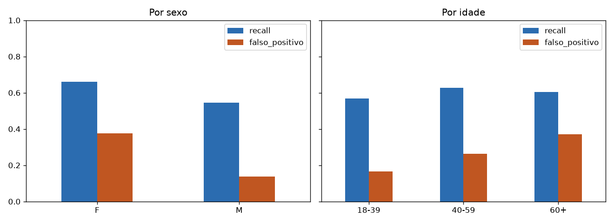

# Relatório do Ir Além 1: ética e governança

**CardioIA Fase 4 | Cap 1: Visão Computacional na Clínica**

## Pergunta

A CNN do zero erra igual para todos os grupos de pacientes? Avaliamos sexo e faixa etária nas 336 imagens de teste.

## Limitações do dataset

- **Desbalanceamento original.** Só 2,5% das imagens do NIH têm cardiomegalia. Igualamos as classes para treinar, mas isso não reflete a realidade.
- **Perfil diferente entre as classes.** Na cardiomegalia há mais mulheres (57% contra 47%) e mais pessoas com 60 anos ou mais (33% contra 21%).
- **Representatividade.** As imagens vêm de um único centro, nos Estados Unidos, e não há dados de raça ou etnia. Não sabemos como a rede se sairia no Brasil.
- **Rótulos automáticos.** Foram extraídos dos laudos por processamento de texto, com erros.

## Métricas de fairness

- **Recall** (igualdade de oportunidade): dos doentes, quantos foram encontrados.
- **Falso positivo:** dos saudáveis, quantos receberam alerta errado.
- **Marcados** (paridade demográfica): quanto do grupo recebeu alerta.

| Grupo | Doentes | Saudáveis | Acurácia | Recall | Falso positivo | Marcados |
|---|---|---|---|---|---|---|
| Mulheres | 91 | 80 | 0,643 | 0,659 | **0,375** | 0,526 |
| Homens | 77 | 88 | 0,715 | 0,545 | **0,136** | 0,327 |
| 18 a 39 | 37 | 54 | 0,725 | 0,568 | 0,167 | 0,330 |
| 40 a 59 | 78 | 87 | 0,685 | 0,628 | 0,264 | 0,436 |
| 60 ou mais | 53 | 27 | 0,612 | 0,604 | 0,370 | 0,525 |

Diferenças com intervalo de 95% (bootstrap, 2.000 repetições):

| Comparação | Diferença | Intervalo | Conclusão |
|---|---|---|---|
| Falso positivo, mulheres − homens | +0,239 | 0,103 a 0,367 | **diferença clara** |
| Recall, mulheres − homens | +0,114 | −0,034 a 0,265 | inconclusiva |
| Falso positivo, 60+ − 18 a 39 | +0,204 | 0,000 a 0,426 | no limite, inconclusiva |
| Recall, 60+ − 18 a 39 | +0,036 | −0,172 a 0,239 | inconclusiva |

## Interpretação

A rede dá alarme falso em 37,5% das mulheres saudáveis e em 13,6% dos homens saudáveis. Uma hipótese é que ela tenha aprendido sinais do sexo no raio-X, já que havia mais mulheres na classe doente. O tecido mamário na imagem também pode contribuir. Este trabalho não separa as duas causas. Ao repetir tudo no Colab, com GPU, os números mudaram, mas a diferença se manteve: 40,0% contra 17,0%.

Na prática, mulheres fariam mais exames desnecessários, e homens doentes poderiam passar despercebidos com mais frequência (recall de 0,545), embora essa segunda diferença não seja conclusiva.

## Mitigações propostas

1. **Parear as classes por sexo e idade** na seleção das imagens e treinar de novo. É a primeira a testar: se o alarme falso cair, confirma a hipótese do perfil diferente.
2. **Publicar as métricas por grupo**, e não só a média: a acurácia geral de 0,679 esconde a diferença.
3. **Testar em dados de outro hospital**, de preferência brasileiro.
4. **Escolher o limiar na validação**, avaliando o efeito em cada grupo.
5. **Manter um profissional na decisão.** O modelo não substitui o laudo.

Não aplicamos a correção agora porque ela mudaria os dados depois de ver o teste. O certo é aplicá-la em um novo ciclo, com um teste novo.

## Governança e ética

Os dados são públicos e sem identificação. O projeto informa a fonte, as limitações e que **não serve para diagnóstico**. No Brasil, o uso real envolveria dados sensíveis pela LGPD e precisaria seguir as regras da Anvisa para software médico.
